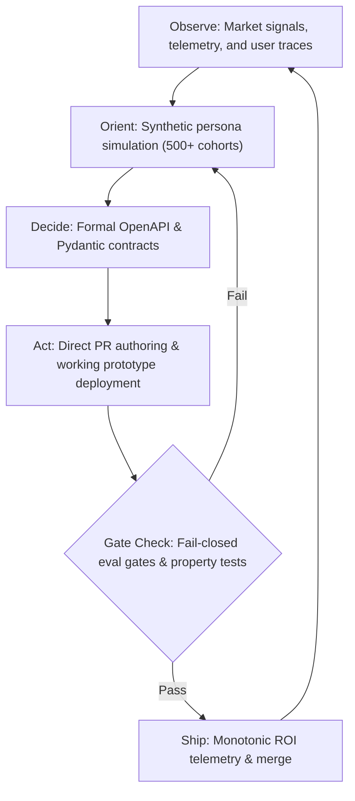

# PERI-METER

> The brand-neutral transformation platform turning Product Managers from ticket-writers into autonomous, code-literate software builders and empirical evaluators.

---

# Mission & Manifesto

Traditional enterprise PM training merely adds AI to the existing waterfall: product managers use language models to draft longer PRDs, generate more Jira tickets, and expand the chasm between specification and implementation. This preserves the slow, handoff-heavy waterfall that modern engineering organizations cannot afford.

**PERI-METER fundamentally changes the game.** We train and verify Product Managers to operate as autonomous builders who:
1. Build working prototypes in hours using prompt-to-app runtimes.
2. Validate ideas across 500+ synthetic customer persona cohorts before committing engineering resources.
3. Author, test, and ship production-quality Pull Requests directly to GitHub repositories.
4. Pair with engineering agents via formal Pydantic and OpenAPI machine contracts.
5. Orchestrate autonomous loops, state graphs, and Model Context Protocol (MCP) integrations.
6. Write fail-closed property tests and evaluation gates instead of vague acceptance criteria.
7. Maintain active GitHub project catalogues and provide leadership with measurable, monotonic ROI telemetry.

---

# The Paradigm Shift: From Ticket Writer to Autonomous Builder

| Dimension | Legacy Ticket-Writer PM | PERI-METER Autonomous Builder PM |
| :--- | :--- | :--- |
| **Primary Deliverable** | Text PRDs, user stories, Jira tickets | Tested PRs, working prototypes, eval suites |
| **Validation Cycle** | Weeks of interviews and customer panels | Hours across 500+ synthetic persona cohorts |
| **Engineering Seam** | Ambiguous natural language handoffs | OpenAPI schemas, typed contracts, Vitest gates |
| **Iteration Loop** | Bi-weekly sprint retrospectives | Fast OODA loops running against live code and gates |
| **Tooling** | Confluence, Jira, slide decks | Vitest, GitHub CLI, MCP servers, Python evals |
| **Economic Impact** | Coordination tax and overhead | Direct engineering hours offset and monotonic ROI |

### The Autonomous Builder PM OODA Loop



---

# The 10 Core Transformation Tracks

PERI-METER organizes its curriculum as a Directed Acyclic Graph (DAG) across 11 core capability tracks:

1. **Track 01 — Prompt-to-App Prototyping Runtime**: Rapid prototyping with headless agent engines, isolated sandboxes, and cloud previews.
2. **Track 02 — Synthetic Customer Persona Cohort Validation**: Running 500+ simulated persona evaluations to stress-test UX flows, value propositions, and price sensitivity.
3. **Track 03 — Direct-to-GitHub PR Authoring & CI Verification**: Branch hygiene, atomic commit conventions, linting, typecheck, and automated PR submission via `gh` CLI.
4. **Track 04 — Contract-Driven Engineer Agent Pairing**: Designing formal Pydantic, TypeScript, and OpenAPI interfaces for deterministic handoffs.
5. **Track 05 — Frontier Tool & Provider Orchestration**: Connecting model APIs (Gemini 3.8 Flash baseline), fallback chains, and streaming responses with local CI mocks.
6. **Track 06 — Autonomous Loops & MCP Server Integration**: Building Model Context Protocol servers and client tool invocations for automated workflows.
7. **Track 07 — Workflow Graph Systems & Evaluation Gates**: Structuring multi-stage DAGs (`lessons_read -> preflight -> approval -> proofs`) with fail-closed gating.
8. **Track 08 — Fail-Closed Property Testing & Scenario Replay**: Porting Lumina offline scenario replay harnesses and verifying invariants over state spaces.
9. **Track 09 — Supervisor-Worker Agent Hierarchies**: Porting Lumina's misconception vs slip classification and hierarchical supervisor-worker agents.
10. **Track 10 — Market Horizon Radar & Frontier Intelligence**: Systematic tracking of frontier model developments, API changes, and competitive telemetry.
11. **Track 11 — Autonomous GitHub Project Catalogue**: Indexing live repositories, deployment links, automated test badges, and verified capability states.

---

# Stitch UI Design System & Personas

PERI-METER adopts the **Stitch Design System** (`theme: neutral-craft`):
- **Surfaces**: Dark zinc/slate palette (`#09090b` background, `#121215` card, `#18181b` subtle surface, `#27272a` borders).
- **Typography**: Dual-font pairing with `Inter` for prose and high-contrast `JetBrains Mono` for code, telemetry, and eval metrics.
- **Accents**: Semantic status indicators (Emerald for green gates, Amber for pending approvals, Rose for failed invariants).

### Dual-Audience Navigation & Routes

- **Trainee PM Experience**:
  - `/learn`: Master transformation curriculum dashboard, capability tracks, prerequisite DAG, and live module progress.
  - `/learn/track/:id`: Deep dive into specific track modules, code sandboxes, rubric property checks, and deliverable submissions.
- **PM Manager & Leadership Experience**:
  - `/manager/roi`: Real-time ROI telemetry engine demonstrating `d(ROI)/d(Skills) >= 0`. Rates default to `8.5h` per PR, `16.0h` per prototype, and `$85/h`, documented as overridable guesstimates in `src/config/roiDefaults.ts`.
  - `/manager/team`: Team roster, certification milestones, aggregate PR throughput, and prototype catalogue.

---

# Local Setup & Execution

### Prerequisites
- Node.js >= 20.0.0
- npm >= 10.0.0
- Python >= 3.10

### Installation
```bash
git clone https://github.com/Redser06/peri-meter-craft.git
cd peri-meter-craft
npm install
```

### Development Server
```bash
npm run dev
```

### Linting & Code Standards
```bash
npm run lint
```

### Test Suite Execution
```bash
npm test
```

---

# Verification, Testing & Eval Gates

PERI-METER enforces rigorous evaluation gates using the fail-closed `eval_runner.py` system:

```bash
# Validate workflow graph and gate registry
python3 tools/eval_runner.py validate-graph \
  --graph gates/perimeter-phase1.graph.yaml \
  --registry gates/perimeter-phase1.registry.json

# Run all property tests and verification checks
npm test
```

### Registered Project Gates
1. `perimeter_approval_recorded`: Human approval check bound to graph SHA.
2. `perimeter_neutral_brand_clean`: Clean scan against host/corporate branding.
3. `perimeter_readme_rich_contract`: Verification of YAML frontmatter and dual-audience contract.
4. `perimeter_state_delta_valid`: 50-state round-trip serialization invariance in TypeScript.
5. `perimeter_pydantic_schema_sync`: Synchronized field definitions across TypeScript and Python schemas.
6. `perimeter_stitch_token_valid`: Stitch CSS token compliance.
7. `perimeter_journey_matrix_verified`: Mounting and verification of all trainee and manager routes.
8. `perimeter_curriculum_dag_acyclic`: Topological sort and cycle-freedom of the 11-track curriculum.
9. `perimeter_eval_suite_deterministic`: Deterministic execution of the curriculum evaluation test suite.
10. `perimeter_roi_monotonic_increasing`: Seeded property test verifying `d(ROI)/d(Skills) >= 0` across 200+ random states.
11. `perimeter_ledger_cap_enforced`: Enforcement of strict $5.00/month LLM cost cap and fail-closed behavior.
12. `perimeter_protected_files`: Zero-diff enforcement against protected configuration files.

---

# Roadmap

- [x] **Phase 1**: Brand-neutral architectural rework, Stitch tokens, curriculum DAG, Lumina state engine port, monotonic ROI model, fail-closed eval gates.
- [ ] **Phase 2**: Interactive Trainee PM lab environment, headless prompt-to-app code runner, and Lumina live session coaching.
- [ ] **Phase 3**: Automated PR bot integration and live GitHub webhook telemetry for enterprise manager dashboards.
