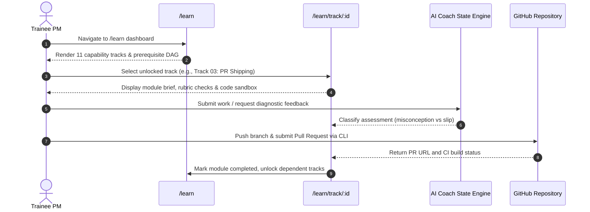
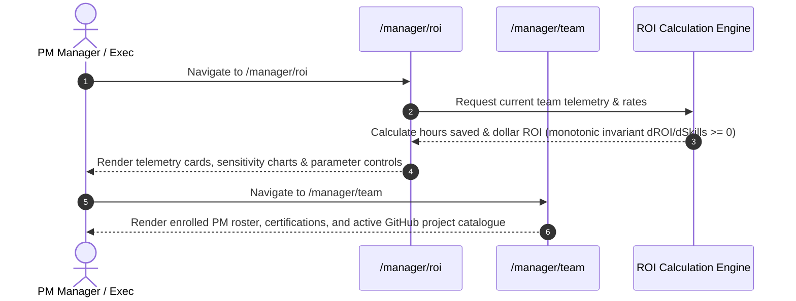

# PERI-METER Journey Maps & Wireframe Specifications

This document outlines the user journey maps and Stitch UI wireframe specifications for the two primary personas in PERI-METER.

---

## Persona A: The Trainee PM (Autonomous Builder)

**Goal**: Transform from drafting PRDs and Jira tickets into autonomously building, validating, and shipping real software.

### Journey Sequence

### Wireframe Specifications

#### 1. Route: `/learn` (Trainee Curriculum Dashboard)
- **Header**: Neutral craft status bar with learner ID, completed modules count, deployed prototypes count, and authored PRs count.
- **DAG Canvas**: Interactive node-link diagram rendering all 11 tracks with lock/unlock status, prerequisite connections, and completion badges.
- **Track Grid**: High-contrast cards (`#121215`, `#27272a` border) displaying track number, title, competencies, prerequisite requirements, and launch action.

#### 2. Route: `/learn/track/:id` (Track Execution Workspace)
- **Breadcrumbs**: `/learn` -> `Track :id: :title`
- **Specification Panel**: Machine contract overview, competency definitions, and rubric property checks.
- **Interactive Sandbox**: Code editor panel, CLI terminal emulation, and test runner triggers.
- **Diagnostic Feedback Drawer**: Real-time feedback powered by Lumina state engine with misconception recovery hints.
- **Deliverable Submission Form**: Pull request URL submission, prototype deployment link, and automated eval gate validation trigger.

---

## Persona B: The PM Manager / Engineering Leadership

**Goal**: Quantify team capability progression, track engineering hours offset, and inspect live project catalogues with monotonic ROI telemetry.

### Journey Sequence

### Wireframe Specifications

#### 1. Route: `/manager/roi` (Monotonic ROI Telemetry Engine)
- **Top Metric Cards**:
  - **Engineering Hours Saved**: `(prsShipped * 8.5) + (prototypesBuilt * 16.0)` (configurable rates).
  - **Estimated Dollar ROI**: `hoursSaved * $85/h` (configurable rates).
  - **Active AI PMs**: Count of PMs with >= 1 shipped PR.
  - **Certification Rate**: Percentage of PMs completing all 11 tracks.
- **Interactive Rate Adjuster**: Sliders/inputs to adjust `hoursPerPr`, `hoursPerPrototype`, and `usdPerHour` (labelled as documented overridable guesstimates).
- **Monotonicity Verification**: Mathematical invariant badge confirming `d(ROI)/d(Skills) >= 0` across all count and rate vectors.

#### 2. Route: `/manager/team` (Team Roster & Project Catalogue)
- **Roster Table**: Trainee name, track progress bar (0/11), authored PR count, deployed prototype count, and certification status.
- **GitHub Project Catalogue**: Filterable grid of live repositories, working demo links, preview channel statuses, and automated test badges.
- **Skill Distribution Chart**: Team-wide radar breakdown of competency density across all 11 transformation tracks.
